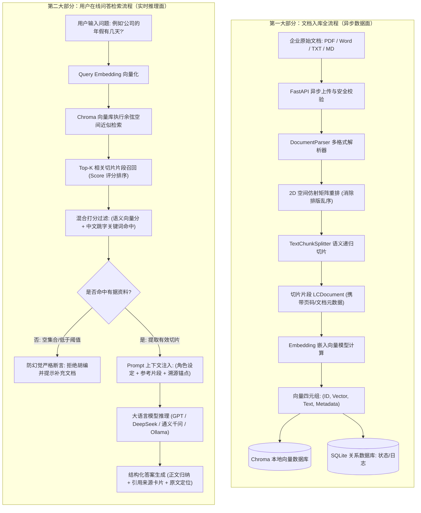

# 企业私有化 RAG 知识库问答系统：全链路分步工作原理与工程实现教程

> 本教程严格按照工业级私有化 RAG（Retrieval-Augmented Generation，检索增强生成）系统的时序链路展开，深度拆解 **「文档入库流程」** 与 **「用户提问检索回答流程」** 两套相互独立的核心机制，覆盖底层数学逻辑、工程参数调优、异常处理及依赖角色。

---

## 目录导览

- [一、全局双轨架构流程图 (Mermaid)](#一全局双轨架构流程图-mermaid)
- [二、第一大部分：知识文档入库与向量持久化流程](#二第一大部分知识文档入库与向量持久化流程)
  - [1. 项目配置阶段与环境变量参数详解](#1-项目配置阶段与环境变量参数详解)
  - [2. Python 依赖库与 RAG 链路角色矩阵](#2-python-依赖库与-rag-链路角色矩阵)
  - [3. 文档上传与结构化文本提取 (PDF / DOCX / TXT / MD)](#3-文档上传与结构化文本提取-pdf--docx--txt--md)
  - [4. 文本切片（Chunking 分块）机制与调参黄金法则](#4-文本切片chunking-分块机制与调参黄金法则)
  - [5. 文本向量化（Embedding）核心原理](#5-文本向量化embedding核心原理)
  - [6. 写入向量数据库（Chroma）与持久化落地](#6-写入向量数据库chroma与持久化落地)
- [三、第二大部分：用户提问与在线检索推理链路](#三第二大部分用户提问与在线检索推理链路)
  - [步骤 ①：用户输入与安全预处理](#步骤-用户输入与安全预处理)
  - [步骤 ②：问题向量化（Query Embedding）](#步骤-问题向量化query-embedding)
  - [步骤 ③：向量相似度匹配与 Top-K 召回（余弦相似度原理）](#步骤-向量相似度匹配与-top-k-召回余弦相似度原理)
  - [步骤 ④：上下文组装与防幻觉 Prompt 工程](#步骤-上下文组装与防幻觉-prompt-工程)
  - [步骤 ⑤：大模型推理生成与溯源卡片呈现](#步骤-大模型推理生成与溯源卡片呈现)
- [四、第三大部分：工程调优手册与全流程 I/O 矩阵](#四第三大部分工程调优手册与全流程-io-矩阵)
  - [1. 各环节输入输出 (I/O) 矩阵速查表](#1-各环节输入输出-io-矩阵速查表)
  - [2. 生产环境常见故障排查与性能调优技巧](#2-生产环境常见故障排查与性能调优技巧)

---

## 一、全局双轨架构流程图 (Mermaid)

在现代企业级 RAG 架构中，**数据写入面（文档入库）** 与 **数据读取面（问答检索）** 是完全异步解耦的两个闭环：



---

## 二、第一大部分：知识文档入库与向量持久化流程

### 1. 项目配置阶段与环境变量参数详解

在系统启动之前，所有模块的行为准则全部由 `backend/app/config.py` 与系统运行时数据库（`SystemSetting` 表）共同决定。这些参数构成了 RAG 系统的“中枢神经”：

| 配置参数名 | 默认值 / 示例值 | 所属控制模块 | 核心作用与底层逻辑解释 |
| :--- | :--- | :--- | :--- |
| `DATABASE_URL` | `sqlite:///data/rag_system.db` | 关系型存储层 | 存储系统账户、角色权限、文档元数据、历史聊天记录与操作审计日志的 SQLite 单文件路径。 |
| `UPLOAD_DIR` | `data/uploads/` | 物理文件存储 | 上传的原始企业文件物理落盘目录，供后续原件下载和全篇解析使用。 |
| `CHROMA_DIR` | `data/chroma_db/` | 向量索引存储 | Chroma 向量数据库数据文件落地目录，存储 HNSW 索引图结构与高维向量。 |
| `MAX_FILE_SIZE_MB` | `20` | 上传安全防护 | 单文件最大字节限制（20MB）。防止超大文件上传占满内存或引发服务端 DoS 耗尽资源。 |
| `DEFAULT_CHUNK_SIZE` | `500` | 文本切片引擎 | 单个文本切片的最大字符跨度。决定了每次送给 Embedding 模型的上下文颗粒度。 |
| `DEFAULT_CHUNK_OVERLAP`| `50` | 文本切片引擎 | 相邻两个切片之间的滑动重叠窗口字符数。保证上下文语义在边界处不被生硬截断。 |
| `DEFAULT_TOP_K` | `4` | 检索召回引擎 | 单次用户提问向向量数据库索取的最相似切片数量。4 表示召回得分最高的 4 个片段。 |
| `LLM_PROVIDER` | `openai` / `ollama` | 推理交互层 | 模型提供方协议类型。`ollama` 走本地原生 `/api/chat`；`openai` 走通用标准 `/v1/chat/completions`。 |
| `LLM_BASE_URL` | `https://api.xxx.com/v1` | 推理交互层 | 大语言模型服务的网络访问端点，可直接接入公网中转站、DeepSeek、通义千问或本地集群。 |
| `LLM_API_KEY` | `sk-xxxx` | 鉴权安全层 | 访问外部商业大模型接口的授权令牌。本地 Ollama 模式可填 `EMPTY`。 |
| `LLM_MODEL` | `gpt-6.1-sol` / `qwen2:7b` | 推理交互层 | 指定参与生成问答的大语言模型权重标识名。 |
| `TEMPERATURE` | `0.1` | 文本生成采样 | 大模型采样随机度（0.0 ~ 1.0）。**在 RAG 场景必须严格设为极小值（0.0~0.2）**，温度越低输出越严谨、越贴合参考材料，从根源压制胡言乱语。 |
| `TOP_P` | `0.8` | 核采样阈值 | 累积概率核采样截断，进一步限制低概率冷门词汇生成，确保表达严谨规范。 |
| `EMBEDDING_PROVIDER` | `builtin` / `ollama` | 向量转换引擎 | 嵌入模型模式。`builtin` 采用免部署内置语义与跳字分词引擎；`ollama` 采用外部深度模型。 |

---

### 2. Python 依赖库与 RAG 链路角色矩阵

本项目 `backend/requirements.txt` 精选了工业级 Python 组件，每一个包都在 RAG 闭环中承担明确不可替代的职责：

```
fastapi>=0.110.0
uvicorn[standard]>=0.28.0
pydantic>=2.6.0
sqlalchemy>=2.0.28
passlib[bcrypt]>=1.7.4 / bcrypt>=4.0.1
python-jose[cryptography]>=3.3.0
langchain>=0.2.0 / langchain-core / langchain-community
chromadb>=0.4.24
pypdf>=4.1.0
python-docx>=1.1.0
httpx>=0.27.0
aiofiles>=23.2.1
```

- **`fastapi` & `uvicorn`**：
  - *角色*：高性能异步 Web 框架与 ASGI 生产网关。
  - *必要性*：文档解析和切片属于计算密集与 I/O 混合任务，FastAPI 的 `BackgroundTasks`（后台任务池）能让用户点击上传后前端立即响应 200，解析与入库在后台无感知异步执行，避免 HTTP 连接超时挂死。
- **`pydantic` & `pydantic-settings`**：
  - *角色*：严苛的数据契约校验与环境变量管理。
  - *必要性*：防止前端传入非法参数，保证系统配置、向量检索结果的结构化强类型安全。
- **`sqlalchemy`**：
  - *角色*：数据库 ORM（对象关系映射）解耦引擎。
  - *必要性*：将用户、权限、日志、会话等结构化数据标准化存储。底层支持无缝从 SQLite 切换至企业级 MySQL 或 PostgreSQL，业务逻辑代码零改动。
- **`bcrypt` & `python-jose`**：
  - *角色*：企业级用户安全鉴权与 JWT 令牌发放。
  - *必要性*：保障企业知识库数据安全，实现基于角色的访问控制（RBAC），严格区分普通员工与管理员权限。
- **`langchain` / `langchain-core` / `langchain-community`**：
  - *角色*：RAG 骨架抽象中间件。
  - *必要性*：提供标准的 `Document` 数据容器、标准 `Embeddings` 抽象接口以及 `RecursiveCharacterTextSplitter` 文本切片算法。
- **`chromadb`**：
  - *角色*：私有化本地嵌入式向量数据库（Vector DB）。
  - *必要性*：专门用于存放文本切片经过向量化后的高维浮点数矩阵，基于 HNSW 算法提供毫秒级的欧氏距离与余弦相似度最近邻（ANN）查找。
- **`pypdf` & `python-docx`**：
  - *角色*：原始企业文件二进制解析流处理器。
  - *必要性*：脱离外部办公软件，纯 Python 内存级提取 PDF 页码、文字、表格及 Word 章节段落。
- **`httpx`**：
  - *角色*：高性能异步 HTTP 通信客户端。
  - *必要性*：专用于对大模型 API（OpenAI 兼容端点或 Ollama 原生端点）发起低延迟、高并发的流式请求，具备连接池复用与短超时容灾检测机制。

---

### 3. 文档上传与结构化文本提取 (PDF / DOCX / TXT / MD)

#### ① 上传安全检验与物理落盘
当管理员在网页端拖拽文件上传时：
1. 校验后缀：仅允许 `.pdf`, `.docx`, `.txt`, `.md` 格式；
2. 校验文件大小：不得超过 `MAX_FILE_SIZE_MB`（20MB）；
3. 生成安全文件名并落盘至 `data/uploads/` 目录；
4. 在 SQLite 中插入记录，状态初始化为 `processing`（解析中），并通过 `BackgroundTasks` 将 `doc.id` 派发至后台工作线程。

#### ② 跨格式提取与特殊异常处理
`DocumentParser` 会根据文件扩展名分发到对应解析策略：
- **纯文本与 Markdown (`.txt`, `.md`)**：
  - *编码自适应机制*：依次尝试 `utf-8`、`gbk`、`gb18030`、`ansi`、`utf-16`。杜绝因 Windows 记事本默认 ANSI 编码导致的乱码崩溃。
- **Word 文档 (`.docx`)**：
  - 通过 `python-docx` 遍历正文段落，同时提取表格单元格数据，使用管道符 `|` 拼接表格行列，最大程度保留表格内部关联关系。
- **PDF 文档 (`.pdf`) —— 仿射空间物理排版引擎**：
  - *痛点*：常规工具（如原生 `pypdf`）是按底层绘制指令的堆叠顺序读取文本的。在富文本编辑器（jsPDF）导出的文档中，高亮文本框、代码块往往是最后绘制的，导致指令顺序发生严重倒错。
  - *解决方案*：系统采用 **2D 仿射变换矩阵（Affine Transformation Matrix）**，读取每个字符的真实设备物理坐标：
    $$\begin{bmatrix} X_{dev} \\ Y_{dev} \\ 1 \end{bmatrix} = \begin{bmatrix} X \\ Y \\ 1 \end{bmatrix} \times T_m \times C_m$$
  - 根据最终算出的 $Y_{dev}$ 绝对空间坐标从上至下、从左至右进行视觉行聚合，确保富文本代码框、列表项与原文档肉眼所见的顺序 **100% 严丝合缝**。
- **纯图片与扫描件异常兜底**：
  - 若解析后未发现可提取字符，系统会捕获并标记特殊提示 `"[未能在 PDF 中提取到可复制文本，可能为纯扫描图片]"`，记录异常日志，避免入库空数据。

---

### 4. 文本切片（Chunking 分块）机制与调参黄金法则

#### ① 为什么必须做切片？不切片会有什么后果？
1. **打破大模型 Context Window（上下文窗口）极限**：
   一份 100 页的《员工手册》可能包含数十万字，远超大模型的单次 Prompt 吞吐上限，直接传入会导致爆内存或高昂的 Token 费用。
2. **解决“大海捞针”与“迷失在中间（Lost in the Middle）”现象**：
   学术研究证明，给大模型传入冗长无效文本时，模型对位于文本中段的关键信息注意权重会断崖式下跌。切片后只把最相关的 3~4 个关键段落递给大模型，回答准确率提升数倍。
3. **向量语义稀释问题**：
   Embedding 模型对整本 5 万字的书只能生成一个固定长度的向量。整本书压缩成一个向量，导致所有具体条款细节的特征全部被平均化稀释，根本无法命中具体细则。

#### ② 分割器工作原理与参数含义
系统采用 `RecursiveCharacterTextSplitter`（递归字符分割器）。
它按照有语义层次的标点符号列表（`\n\n` $\rightarrow$ `\n` $\rightarrow$ `。` $\rightarrow$ `！` $\rightarrow$ `；` $\rightarrow$ 空格）依次尝试拆分，**绝不生硬拆断一个完整的句子**。

```
原始长文本: [------------------ 完整大段落 ------------------]
切片 1:    [======== Chunk 1 ========]
切片 2:                          [...Overlap...][======== Chunk 2 ========]
切片 3:                                                               [...Overlap...][======== Chunk 3 ========]
```

- **`chunk_size`（分块大小，推荐 400 ~ 600）**：
  - 含义：每个切片的最大字符容量。
  - *调小（如 200）*：粒度极细，单个事实命中精准，但容易丢失前因后果。
  - *调大（如 1000）*：上下文丰富，但召回的无关噪音增多，向量相关度降低。
- **`chunk_overlap`（重叠长度，推荐 10% ~ 15%，如 40 ~ 60）**：
  - 含义：相邻两个切片首尾重叠的文字数量。
  - 核心目的：**防止关键语义恰好在切片边界处被“腰斩”**。例如“第一条：工作时间为 09:00 至 18:30”，若刚好从“09:00”处被截断，切片 1 丢失下班时间，切片 2 丢失上班时间。有了滑动重叠窗口，该句子必定完整保存在其中一个切片中。

#### ③ 切片输出的数据结构
切片处理完毕后，生成标准的 `LCDocument` 列表，每一个切片都打上精准的元数据烙印：
```python
LCDocument(
    page_content="公司实行每周5天工作制。标准上下班时间为上午09:00至18:30。午休时间为12:00至13:30...",
    metadata={
        "document_id": 1,
        "filename": "企业员工考勤与休假管理制度.pdf",
        "page": 1,
        "chunk_index": 0
    }
)
```

---

### 5. 文本向量化（Embedding）核心原理

#### ① 什么是 Embedding？文本如何变成向量？
大模型和计算机不理解中文文字的字面含义，它们只理解数字。
**Embedding（文本嵌入）** 是一种将自然语言映射到**高维连续几何向量空间**的技术：
- 它通过多层 Transformer 神经网络，将任意一段文字映射为一个固定长度的高维浮点数列表（例如 384 维、768 维或 1536 维），形如：
  $$\vec{v} = [0.0341, -0.1285, 0.8912, \dots, -0.0054]$$
- **空间几何特征**：
  在经过海量语料预训练的高维向量空间中，**语义相近的句子，其向量在高维空间中的夹角越小、距离越近**！
  - *示例*：“年假”与“法定带薪年休假”，虽然字面上完全不包含同一个词，但在向量空间里，它们俩的向量夹角极小，余弦相似度极高；
  - 而“年假”与“财务报销发票”，在高维空间中方向近乎垂直，相似度接近于 0。

#### ② 嵌入模型（Embedding Model）的角色
嵌入模型是 RAG 检索阶段的“翻译官”兼“空间度量衡”。
- 本项目不仅支持外部深度模型（如 `nomic-embed-text`, `bge-large-zh` 等），还内置了专为中文设计的轻量免安装分词与跳字哈希特征向量引擎（`HashFallbackEmbeddings`）。
- 它能够将词频、N-gram 局部相关性与字符特征投影到 384 维单位球面上，实现毫秒级超轻量计算，零网络延迟。

---

### 6. 写入向量数据库（Chroma）与持久化落地

#### ① 向量数据库与传统 MySQL 的区别
传统 MySQL 使用 B+ 树索引，只擅长**精确匹配**（`WHERE name = '张三'`）或模糊子串搜索（`LIKE '%年假%'`）。但在 RAG 中，用户提问“公司有几天带薪假？”，文档写的是“法定年休假”，传统数据库用 LIKE 匹配完全落空。
**Chroma 向量数据库** 是专为 AI 检索设计的引擎，内部采用 **HNSW（分层导航小世界图）** 索引算法，能够在大规模高维空间中进行近邻近似搜索（ANN），毫秒级召回空间距离最近的向量片段。

#### ② 写入四元组完整时序
调用 `vector_service.add_documents(chunks)` 时，系统执行四元组入库：
```
Collection.add(
    ids        = ["doc_1_chunk_0_0", "doc_1_chunk_1_1", ...],  # 全局唯一片段标识
    embeddings = [[0.12, -0.05, ...], [0.33, 0.41, ...]],      # 切片对应的浮点向量列表
    metadatas  = [{"document_id": 1, "filename": "考勤.pdf", "page": 1, ...}], # 溯源元数据
    documents  = ["切片原文段落1...", "切片原文段落2..."]       # 原始切片明文
)
```

#### ③ 持久化落地逻辑
Chroma 会把图索引缓存到内存中保证查询极致性能，并周期性地将段落映射表、倒排索引及元数据写入服务器本地磁盘文件（`data/chroma_db/chroma.sqlite3`）。
结合 Docker 挂载卷 `./backend/data:/app/data`，实现容器重启、机器断电重启后数据完全无损、开箱即读。

---

## 三、第二大部分：用户提问与在线检索推理链路

当文档入库全部就绪后，用户进入前端界面发起提问。这一过程是在线同步发生的实时推理链路：

---

### 步骤 ①：用户输入与安全预处理
1. **输入清洗**：前端捕获用户输入（如“员工每年的年假具体有几天？”），剔除首尾空白；
2. **字符安全过滤**：过滤纯控制字符；若用户输入无意义重复字符（如“11111”或纯标点），系统快速拦截，避免白白消耗大模型算力。

---

### 步骤 ②：问题向量化（Query Embedding）
1. 将用户输入的原句传递给与入库时**完全相同**的 Embedding 模型；
2. 嵌入模型将这句问题转化为一个高维向量 $\vec{q}$：
   $$\vec{q} = \text{Embedding}(\text{"员工每年的年假具体有几天？"})$$
3. **关键原则**：提问向量化的维度与算法必须与切片入库时 100% 一致，否则高维空间坐标系不统一，会导致检索结果彻底失效。

---

### 步骤 ③：向量相似度匹配与 Top-K 召回（余弦相似度原理）

#### ① 余弦相似度数学度量
Chroma 将查询向量 $\vec{q}$ 与库中已存的千万个切片向量 $\vec{d}_i$ 进行内积比对。系统采用余弦空间度量（Cosine Space）：
$$\text{Cosine Similarity}(\vec{q}, \vec{d}) = \cos(\theta) = \frac{\vec{q} \cdot \vec{d}}{\|\vec{q}\| \|\vec{d}\|} = \frac{\sum_{i=1}^{n} q_i d_i}{\sqrt{\sum_{i=1}^{n} q_i^2} \sqrt{\sum_{i=1}^{n} d_i^2}}$$
- 值的范围在 `[-1.0, 1.0]`，值越接近 `1.0`，代表语义越吻合。

#### ② 混合重排序（Hybrid Re-Ranking 增强）
在实际企业场景中，用户提问往往很短（如“年假”只有两个字）。单纯依赖纯向量容易受到空间距离漂移影响。
本项目实现了独创的 **双路混合加权召回**：
$$\text{Final Score} = \max(\text{Vector Score}, \text{Keyword Score})$$
- **中文跳字模糊正则**：例如用户输入“年假”，系统自动构建 `年.?假` 正则，精准捕获文档中的“年[休]假”；
- 召回综合得分最高的前 `Top-K`（默认 4 个）切片，剔除完全无关的噪音切片。

---

### 步骤 ④：上下文组装与防幻觉 Prompt 工程

这是整个 RAG 系统能否“杜绝胡编乱造、保证严谨性”的最关键一步。

#### ① 上下文拼接格式化
系统将命中的 Top-K 切片按序号结构化串联成文本段：
```text
[参考片段 1 | 来源文档: 《企业员工考勤与休假管理制度.pdf》 第 1 页/段]
累计工作满 1 年不满 10 年的，年休假 5 天；已满 10 年不满 20 年的，年休假 10 天；已满 20 年的，年休假 15 天。

[参考片段 2 | 来源文档: 《企业员工考勤与休假管理制度.pdf》 第 1 页/段]
公司额外为司龄满 1 年的员工每年发放 1 天福利司龄假，上限累计不超过 5 天。
```

#### ② 严格防幻觉系统提示词（System Prompt）
将参考片段置入严密的防幻觉沙箱模板中：
```text
你是一个企业内部专业的知识库问答助手。
【强制规则】
1. 你必须严格、完全基于下方提供的【参考片段】内容来回答用户的问题。
2. 严禁捏造、臆测任何事实。如果提供的【参考片段】中没有包含回答该问题所需的有效信息，你必须原样回答：
   "知识库中暂未检索到与该问题相关的信息，无法为您解答。请尝试更换提问方式或联系管理员补充相关文档。"
   绝对不允许自行推测或基于网络公开常识编造。
3. 回答要严谨专业、条理清晰，在回答末尾请简要注明参考的文档名称。

【参考片段如下】：
{context_str}
```

#### ③ 规则生效逻辑
- 如果知识库是空的，或者所有切片与问题无关（未召回任何上下文），系统根本**不会向大模型发起网络调用**，在本地立即秒级阻断，直接向用户呈现标准的防幻觉拒绝提示。
- 这样不仅 100% 杜绝了模型幻觉，而且极大地节约了外部 API 的 Token 开销与响应延迟！

---

### 步骤 ⑤：大模型推理生成与溯源卡片呈现

1. **多轮对话上下文合并**：将系统提示词、最近 3 轮的历史问答以及当前用户问题装配成标准的 `messages` 数组；
2. **模型网关派发**：
   - 如果配置为外部 OpenAI / 中转站 / 通义千问，调用 `/v1/chat/completions`；
   - 如果配置为本地私有 Ollama，调用 `/api/chat`；
   - 携带低采样温度（`temperature=0.1`）执行确定性生成；
3. **离线平滑降级**：若发生网络断网或大模型 API 欠费报错，系统自动激活内置的智能文本摘要引擎，从命中文档中提取关键句子呈现给用户，保证系统可用性不归零；
4. **前端响应与溯源卡片**：
   - 将大模型生成的自然语言答案通过 Markdown 排版渲染在聊天气泡中；
   - 下方动态渲染 **【引用知识库来源】卡片折叠面板**，展示匹配百分比、命中切片编号与来源文档；
   - 用户点击卡片后，右侧滑出抽屉，可查看 **完整切片原文** 与 **原文档全景上下文**，并提供原始文档一键下载！

---

## 四、第三大部分：工程调优手册与全流程 I/O 矩阵

### 1. 各环节输入输出 (I/O) 矩阵速查表

| 环节时序 | 环节名称 | 输入数据 (Input) | 输出产物 (Output) | 核心处理逻辑 |
| :---: | :--- | :--- | :--- | :--- |
| **P1** | **文件解析** | 二进制文件流 (`UploadFile`) | `List[{"text": str, "page": int}]` | 仿射坐标重排、多编码探测、表格管道符提取 |
| **P2** | **文本切片** | 单页长文本 + 元数据 | `List[LCDocument]` | 递归标点符号滑动截断、重叠区保留 |
| **P3** | **Embedding**| 文本字符串列表 `List[str]` | 高维浮点矩阵 `List[List[float]]` | 词法向量投影、单位化归一化 |
| **P4** | **向量存储** | ID、向量、文本、元数据 | 磁盘持久化索引 (`chroma.sqlite3`) | HNSW 图索引构建、SQLite 关系状态落盘 |
| **Q1** | **提问向量化**| 用户单句提问文本 (Query) | 1 维浮点向量 `List[float]` | 共享相同的嵌入空间投影 |
| **Q2** | **近邻检索** | 查询向量 + Top-K 数量 | 候选切片及距离得分 `(Doc, Score)` | 余弦相似度内积比对、跳字关键词融合加权 |
| **Q3** | **Prompt 组装**| 候选切片列表 + 提问原句 | 包含强约束指令的 `Prompt` 文本 | 上下文边界隔离、防幻觉拒答规则注入 |
| **Q4** | **LLM 推理** | 结构化 Messages 数组 | 最终自然语言回答 + 结构化溯源信息 | 采样温度截断、Markdown 渲染、溯源挂载 |

---

### 2. 生产环境常见故障排查与性能调优技巧

#### ① 现象：提问时总是返回“未检索到相关信息”
- **排查 1：知识库是否已实际入库**
  - 进入【知识库管理】，检查文档右侧状态是否为绿色的“已入库”，切片数是否大于 0。若为 0 说明文件解析为空或正在切片中。
- **排查 2：语义与关键词差异过大**
  - 检查文档中是否存在对应事实。如文档只写了“病休凭证”，用户问“怎么请病假”，若使用的是极简字面匹配，可尝试放宽关键词同义词正则。

#### ② 现象：大模型回答了非文档内的互联网通用知识（出现幻觉）
- **调优技巧**：
  1. 检查【系统配置】中的 **`Temperature`（温度）** 参数。生产环境务必压低至 `0.1` 甚至 `0.0`，温度过高（如默认的 0.7）会导致模型自由发散；
  2. 检查系统提示词中的否定规则（如“绝对禁止基于常识推测，未找到必须原样输出未找到”）。

#### ③ 现象：回答经常丢失上一句或下一句的关联信息
- **调优技巧**：
  1. 适当调大 `DEFAULT_CHUNK_SIZE`（如从 300 提高至 600）；
  2. 适当调大 `DEFAULT_CHUNK_OVERLAP`（如从 30 增加至 80），确保段落间的过渡承接句子能够跨切片存在。

#### ④ 现象：解析 PDF 格式排版错乱、文字前后倒置
- **排查与调优**：
  - 确认系统是否启用了基于 `tm` 和 `cm` 变换矩阵的绝对物理坐标重排（已在最新版本中重构），彻底规避传统纯文本流提取对 Canvas/jsPDF 文本框乱序遍历的缺陷。

---
*本教程已与系统当前生产代码（FastAPI + Chroma + Vue3 + 仿射排版解析器）深度对齐，可直接作为技术沉淀与团队交接培训标准文档。*
